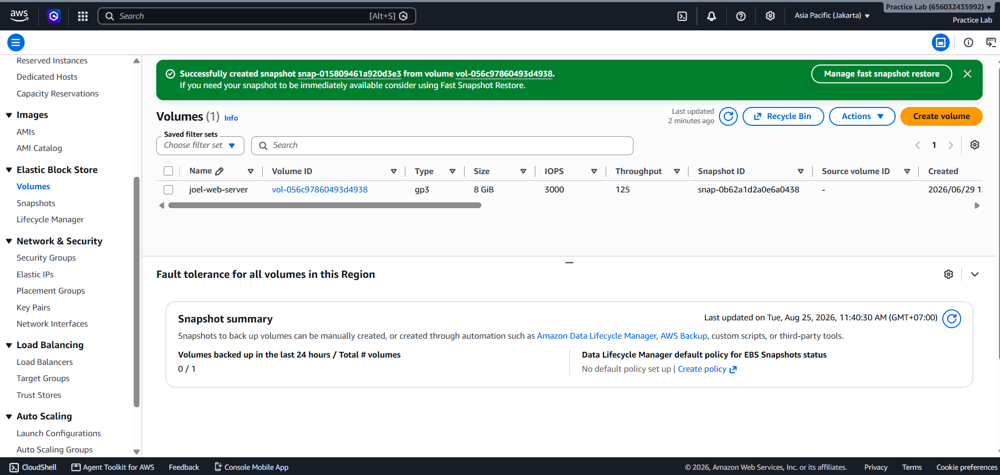
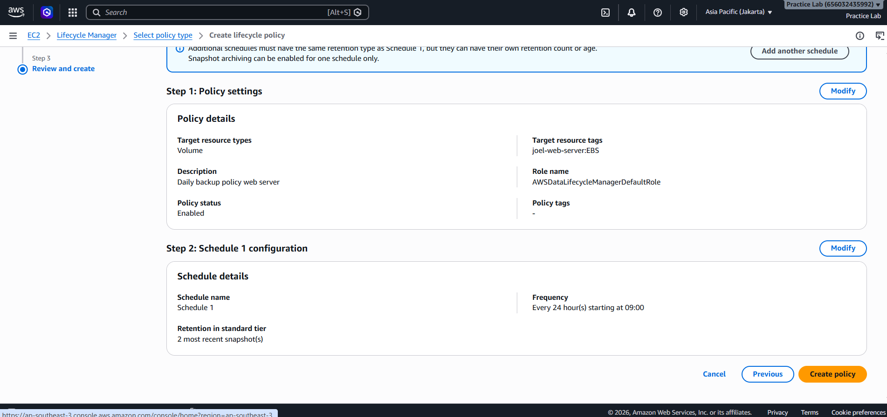
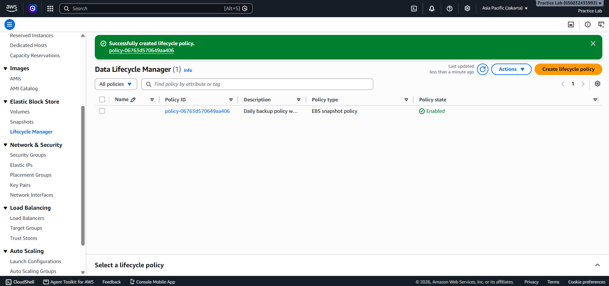
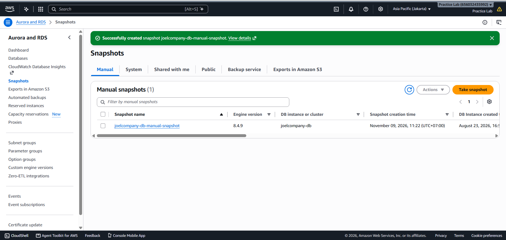

# Fase 4: Backup, Snapshot & Lifecycle Management

Fase ini berfokus pada strategi Disaster Recovery (DR) dan efisiensi biaya penyimpanan melalui otomatisasi retensi backup.

---

## 1. EBS Volume Backup & Automation

### Implementasi
- Manual Snapshot: Membuat point-in-time recovery point sebelum perubahan sistem besar.
- Automated Lifecycle (DLM): Menerapkan policy Amazon Data Lifecycle Manager untuk rotasi harian dengan retensi 7 snapshot.

### Tangkapan Layar Dokumentasi

Pembuatan Snapshot manual yang dilakukan tanpa memakai DLM.

Proses custom mengisi aturan pada DLM.

Hasil akhir DLM siap pakai.

## 2. RDS Database Backup & Recovery Strategy

### Implementasi
- Automated Backups: Mengaktifkan backup otomatis harian dengan *Point-in-Time Restore* (PITR) enabled.
- Manual DB Snapshot: Membuat snapshot manual sebagai *baseline backup* sebelum perubahan skema database major.

### Tangkapan Layar Dokumentasi
