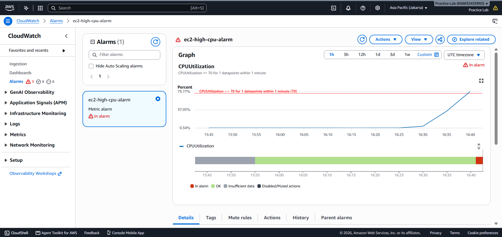
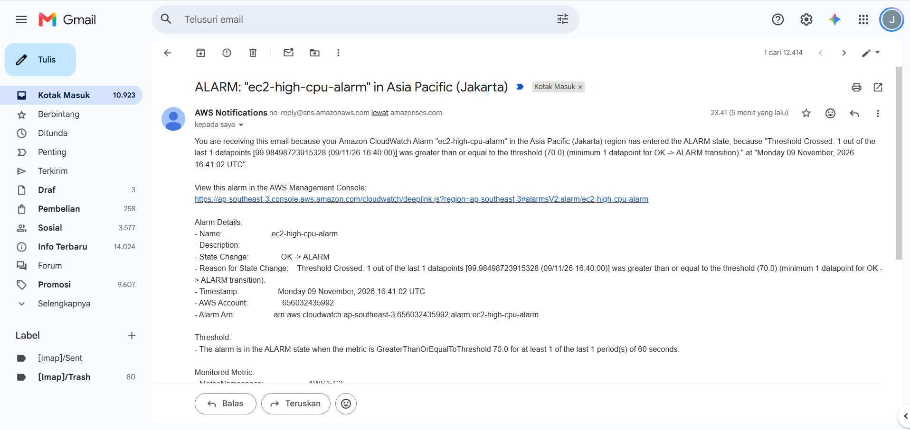

# Fase 5: Monitoring & Alerting (CloudWatch & SNS)

Fase ini bertujuan membangun Visibilitas Operasional dan Sistem Peringatan Otomatis (*Proactive Alerting*) untuk menjaga uptime aplikasi.

---

## 1. Amazon SNS (Notification Service) Setup

### Implementasi
- SNS Topic: Membuat topik joel-company-alerts sebagai jalur distribusi notifikasi infrastruktur.
- Email Subscription: Mengaitkan alamat email administrator ke SNS Topic untuk menerima peringatan *real-time*.

### Tangkapan Layar Dokumentasi

---

## 2. CloudWatch Alarm & Stress Test Verification

### Implementasi
- Metric Binding: Mengikat matriks CPUUtilization pada EC2 Instance joel-web-server.
- Threshold Rule: Trigger aktif jika CPU >= 70% dalam interval 1 menit.
- Automated Action: Mengirim *payload* notifikasi ke SNS Topic joel-company-alerts.
- Stress Test Validation: Menguji pemicu alarm menggunakan utilitas stress di EC2 terminal.

### Tangkapan Layar Dokumentasi

