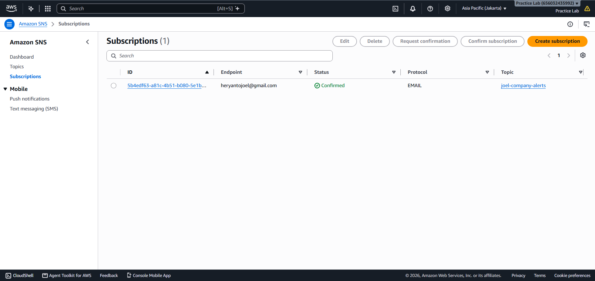

# Fase 5: Monitoring & Alerting (CloudWatch & SNS)

Fase ini bertujuan membangun Visibilitas Operasional dan Sistem Peringatan Otomatis (*Proactive Alerting*) untuk menjaga uptime aplikasi.

---

## 1. Amazon SNS (Notification Service) Setup

### Implementasi
- SNS Topic: Membuat topik joel-company-alerts sebagai jalur distribusi notifikasi infrastruktur.
- Email Subscription: Mengaitkan alamat email administrator ke SNS Topic untuk menerima peringatan *real-time*.

### Tangkapan Layar Dokumentasi
