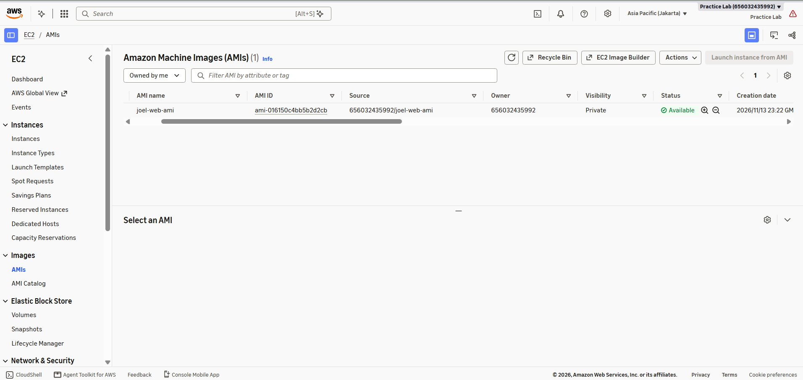

# Fase 6: High Availability & Auto Scaling (ALB & ASG)

Fase ini mentransformasi arsitektur *single-instance* menjadi sistem *Multi-AZ High Availability* yang mampu mendistribusikan trafik secara merata dan melakukan pemulihan otomatis (*self-healing*).

---

## 1. Golden AMI Creation (Immutable Server Image)

### Implementasi
- Health Check Endpoint: Menambahkan index.html sebagai *root health check* agar Load Balancer dapat memvalidasi status HTTP 200 OK.
- **Custom AMI (joel-web-ami):** Membuat *image* dari instance joel-web-server yang telah terkonfigurasi dengan Apache, PHP, modul php-mysqli, dan kode integrasi RDS.

### Tangkapan Layar Dokumentasi
